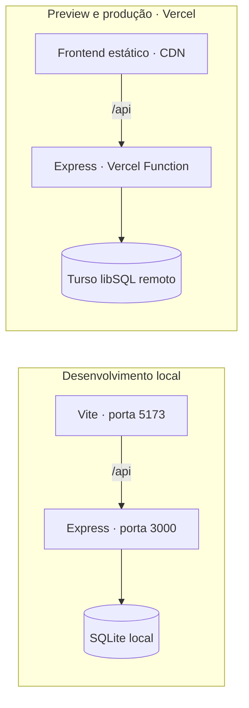

# Meu Ponto

**Sistema de Controle de Jornada · Projeto Integrador em Computação II · UNIVESP · 2026**

[](https://github.com/josepauloferreira/pi-ii-controle-jornada/actions/workflows/ci.yml)

Uma aplicação web de **acompanhamento individual da jornada em home office**. Permite registrar marcações de ponto, calcular horas trabalhadas e saldo, consultar o histórico e exportar os dados — em uma interface responsiva, com autenticação e persistência no servidor.

**[Acessar demonstração](https://pi-ii-controle-jornada.vercel.app)** · [Executar localmente](#executar-localmente) · [Arquitetura](#arquitetura-e-ambientes) · [Testes e qualidade](#testes-e-qualidade) · [Documentação](#documentação)

> Protótipo acadêmico de uso individual. Utilize dados fictícios na demonstração. A aplicação não é homologada como sistema oficial de controle de ponto.

## Funcionalidades

- **Registro de ponto:** entrada, saída para almoço, retorno e saída do expediente.
- **Acompanhamento diário:** horas trabalhadas, jornada prevista e saldo; expedientes incompletos aparecem como “Em andamento”.
- **Histórico mensal:** consulta, edição e exclusão de registros, incluindo batidas extras com descrição.
- **Configurações pessoais:** nome de exibição, jornada diária e início da semana.
- **Exportação e backup:** histórico em CSV, backup JSON e restauração transacional mediante confirmação.
- **Acesso pessoal:** cadastro inicial de uma conta, login, logout e troca de senha com invalidação das sessões anteriores.

Todos os horários usam **24 horas**, no formato `HH:mm`. Por exemplo, `08:30` e `18:30`; ao digitar `1830`, o campo converte para `18:30`. Valores fora de `00:00` a `23:59` são rejeitados.

## Arquitetura e ambientes

O frontend usa **HTML, CSS, JavaScript e Vite**. A API é desenvolvida com **Node.js e Express**, com dois adaptadores de persistência que mantêm o mesmo contrato HTTP.

| Ambiente | Frontend | API | Persistência |
| --- | --- | --- | --- |
| Desenvolvimento local | Vite, porta `5173` | `backend/server.js`, porta `3000` | SQLite com `better-sqlite3` |
| Preview | Arquivos estáticos na Vercel | Vercel Function → `backend/cloud.cjs` | Turso libSQL exclusivo de testes |
| Produção | Arquivos estáticos na Vercel | Mesma Function | Turso libSQL e credenciais próprios |

Localmente, o Vite encaminha `/api` para o Express. Na Vercel, `api/index.js` recebe as chamadas da API e utiliza `@libsql/client/web` para acessar o Turso. Credenciais ficam exclusivamente no servidor; a Function não depende de um arquivo SQLite persistente.

**Os ambientes têm bancos independentes.** Registros, contas e configurações não são sincronizados automaticamente entre local, Preview e produção.



A arquitetura preserva o mesmo **contrato HTTP** em desenvolvimento e na nuvem. As duas implementações são verificadas pelo conjunto compartilhado de testes de integração descrito em [TESTES.md](TESTES.md).

## Executar localmente

### Requisitos

- **Node.js 24 LTS**, recomendado; também é aceita a série 22 a partir de `22.12`.
- **npm** e **Git**.

Os comandos abaixo partem da raiz do repositório.

### 1. Obter o projeto e instalar as dependências

```bash
git clone https://github.com/josepauloferreira/pi-ii-controle-jornada.git
cd pi-ii-controle-jornada
npm ci
npm --prefix backend ci
```

Frontend e backend possuem lockfiles próprios. Use `npm ci` para reproduzir as versões versionadas. O backend local usa o módulo nativo `better-sqlite3`; se a instalação for bloqueada pela política de scripts do npm, consulte o [guia de instalação e deploy](DEPLOY-VERCEL.md#instalação-e-testes-reproduzíveis).

### 2. Iniciar a API

Em um terminal:

```bash
npm --prefix backend start
```

### 3. Iniciar a interface

Em outro terminal:

```bash
npm run dev
```

Abra **[http://localhost:5173](http://localhost:5173)**. Mantenha os dois processos em execução e encerre cada um com `Ctrl+C`.

A porta `3000` atende à API e à demonstração legada; a interface atual, com autenticação, está na porta `5173`. No GitHub Codespaces, abra a porta `5173` e mantenha ambas as portas como **Private**, inclusive durante o primeiro cadastro.

## Cadastro inicial e segurança

**Cada instalação admite uma única conta.** Quando seu banco ainda não tem conta, aparece **Criar conta**. Depois do cadastro, a tela oferece apenas **Entrar** e o backend bloqueia novos cadastros. A ausência do botão de cadastro em uma instalação já inicializada é o comportamento esperado.

O usuário deve ter de 3 a 40 caracteres, começar com uma letra e usar letras, números, ponto, hífen ou sublinhado. A senha exige pelo menos **12 caracteres**, com limite de 256 bytes. Não existem credenciais predefinidas, painel de administradores, múltiplos funcionários ou recuperação pública de senha.

- Senhas são armazenadas com **scrypt e salt aleatório**.
- Sessões ficam no banco; cookies usam `HttpOnly`, `SameSite=Strict` e `Secure` em HTTPS.
- Rotas de dados exigem autenticação, e operações de escrita também exigem o token **CSRF** da sessão.
- O login tem limite de tentativas. Na nuvem, o controle é compartilhado entre as instâncias da Function.
- A troca de senha invalida todas as sessões anteriores.

Quem acessa primeiro uma base vazia pode criar sua conta única. Mantenha o **Preview protegido por Vercel Authentication**. Em produção, faça o primeiro cadastro no deployment protegido antes de liberar o domínio público, conforme o [procedimento de publicação](DEPLOY-VERCEL.md).

## Dados e backups

### Armazenamento

O backend local cria `backend/dados/jornada.db`. Essa pasta é ignorada pelo Git e excluída dos uploads para a Vercel. Para usar outra base local, defina `MEU_PONTO_DB_PATH` com o caminho de um arquivo em uma pasta existente.

Na nuvem, registros, configurações, conta, sessões e limites de login ficam no Turso. Um redeploy não substitui o banco remoto. Mantenha cópias de segurança fora do deployment.

| Ação | Resultado |
| --- | --- |
| **Exportar CSV** | Baixa o histórico do mês selecionado para consulta em planilha. |
| **Fazer backup** | Baixa JSON com registros e configurações do ambiente atual. |
| **Restaurar backup** | Substitui todos os registros do destino e as configurações presentes no arquivo, após confirmação. |

Backups JSON **não incluem senhas nem sessões**. A restauração valida o conteúdo antes da escrita e aplica as alterações em transação; uma falha causa rollback. Faça um backup atual antes de restaurar e confira o ambiente de destino. O CSV não é um formato de restauração.

### Dados do protótipo antigo

Registros antigos do `localStorage` permanecem preservados no navegador. Quando encontra datas locais ausentes no servidor, a interface oferece uma migração **opcional**, sem substituir dias já existentes. Também é possível baixar uma cópia separada desses dados antigos. Informações de outro navegador ou endereço não são migradas automaticamente.

O cadastro de uma conta não apaga registros de jornada já existentes. A transferência entre ambientes é manual, por backup JSON, e deve ser autorizada pelo responsável pelos dados.

## Testes e qualidade

O projeto tem **testes automatizados de integração HTTP** para SQLite e libSQL, um teste do entrypoint serverless e evidências de validação na Vercel. As suítes de Node usam **bancos temporários**; não precisam de tokens Turso nem alteram dados reais.

Depois de instalar as dependências (veja [Executar localmente](#executar-localmente)), execute:

```bash
npm --prefix backend test   # Express + SQLite
npm run test:cloud          # Express + libSQL e roteamento da Vercel
npm run build               # Compilação do frontend Vite
```

| Verificação | Como é executada | Evidência registrada |
| --- | --- | --- |
| Backend local SQLite | `backend/auth.test.js` + contrato compartilhado | **17 testes aprovados**, 0 falhas |
| Backend em nuvem libSQL | `backend/cloud.test.cjs` + `backend/entry.test.cjs` | **41 testes aprovados**, 0 falhas |
| Frontend | `npm run build` → `dist/` | Build Vite aprovado |
| Preview hospedado | HTTP + navegador Chromium/Playwright, **não versionado como suíte E2E** | **14 cenários aprovados** |
| Produção | Smoke tests de disponibilidade e acesso | Verificações registradas separadamente |

Os números acima vêm dos relatórios de 17/10/2026. Não são uma medição de percentual de cobertura nem uma nova execução desta documentação. O contrato em `backend/api-contract.cjs` cobre autenticação, CSRF, datas e horários `HH:mm`, histórico, configurações, backups e erros da API.

O workflow de **GitHub Actions** executa automaticamente as suítes e o build em **Node.js 22 e 24** para PRs direcionados à `main`. A [primeira execução da CI passou nas duas versões](https://github.com/josepauloferreira/pi-ii-controle-jornada/actions/runs/39052232752), e o workflow foi integrado à `main` pelo [PR #29](https://github.com/josepauloferreira/pi-ii-controle-jornada/pull/29). Testes E2E reproduzíveis e testes unitários dos cálculos de jornada ainda são melhorias futuras.

**[Ler a estratégia completa de testes, a matriz de cobertura e as limitações](TESTES.md)** · [Evidências do Preview](VALIDACAO-PREVIEW.md) · [Evidências de produção](VALIDACAO-PRODUCAO.md)

## Hospedagem e configuração

**Demonstração online:** [pi-ii-controle-jornada.vercel.app](https://pi-ii-controle-jornada.vercel.app). A instalação de produção já possui sua conta única; o acesso ao painel exige login.

O [Preview da branch de deploy](https://pi-ii-controle-jornada-git-feat-deploy-vercel-turso-ze17.vercel.app) exige acesso pela Vercel. Cada ambiente mantém sua própria conta única.

| Variável | Uso |
| --- | --- |
| `TURSO_DATABASE_URL` | URL libSQL do banco exclusivo do ambiente Vercel. |
| `TURSO_AUTH_TOKEN` | Token privado desse banco, armazenado como Secret na Vercel. |
| `MEU_PONTO_DB_PATH` | Opcional, somente no backend SQLite local. |

O desenvolvimento local padrão não exige credenciais Turso. O arquivo [.env.example](.env.example) documenta os nomes das variáveis, sem valores privados. Não use prefixo `VITE_` para segredos e não versione arquivos de ambiente, tokens ou cookies.

O projeto Vercel utiliza Node.js `24.x`, preset Vite, instalação `npm ci`, build `npm run build`, saída `dist` e região `iad1`. Preview usa `meu-ponto-pi2-preview`; produção usa `meu-ponto-pi2-prod`, com credenciais próprias e sem importação automática de dados.

Deployments de branches geram previews. O deploy automático da `main` está desabilitado para permitir uma publicação controlada de produção: gerar o deployment com `--target production --skip-domain`, inicializar a conta sob proteção e promover o deployment validado. Os comandos completos, a rotação de tokens e o processo de atualização estão em [DEPLOY-VERCEL.md](DEPLOY-VERCEL.md).

## Estrutura do repositório

```text
.
├── index.html                 # Interface da aplicação
├── src/
│   ├── main.js                # Interações, autenticação e chamadas à API
│   └── style.css              # Estilos e responsividade
├── api/index.js               # Entrada da Vercel Function
├── backend/
│   ├── server.js              # API Express local
│   ├── auth.js                # Autenticação local
│   ├── database.js            # Persistência SQLite local
│   ├── cloud.cjs              # API Express com Turso libSQL
│   ├── api-contract.cjs       # Contrato HTTP compartilhado pelos testes
│   └── *.test.*               # Testes de integração
├── vite.config.js             # Configuração e proxy de desenvolvimento
├── vercel.json                # Build, região e roteamento de nuvem
├── .github/workflows/ci.yml  # CI em Node.js 22 e 24
├── TESTES.md                  # Estratégia e matriz de testes
├── DEPLOY-VERCEL.md           # Instalação, ambientes e publicação
├── VALIDACAO-PREVIEW.md       # Evidências da validação executada
└── Projeto-PI-Ponto.html       # Protótipo original com armazenamento local
```

## API

Todas as rotas usam o prefixo `/api`. Dados de jornada exigem sessão autenticada; escritas autenticadas exigem o header `X-CSRF-Token`.

| Método | Rota | Finalidade |
| --- | --- | --- |
| `GET` | `/api/health` | Verificar disponibilidade; na nuvem, também verifica o banco. |
| `GET` | `/api/auth/status` | Consultar se o cadastro inicial está disponível. |
| `POST` | `/api/auth/register` | Criar a primeira e única conta. |
| `POST` | `/api/auth/login` | Iniciar sessão. |
| `GET` | `/api/auth/me` | Consultar a sessão autenticada. |
| `POST` | `/api/auth/logout` | Encerrar sessão. |
| `POST` | `/api/auth/password` | Alterar senha e invalidar sessões. |
| `GET` | `/api/registros` | Listar registros; aceita `?mes=AAAA-MM`. |
| `GET`, `PUT`, `DELETE` | `/api/registros/:data` | Consultar, salvar ou excluir um dia em `AAAA-MM-DD`. |
| `GET`, `PUT` | `/api/configuracoes` | Consultar ou atualizar configurações. |
| `PUT` | `/api/backup` | Restaurar registros e configurações. |

## Documentação

- [TESTES.md](TESTES.md): comandos reproduzíveis, contrato compartilhado, matriz de testes, CI e limitações conhecidas.
- [DEPLOY-VERCEL.md](DEPLOY-VERCEL.md): instalação reproduzível, variáveis, proteção, atualizações e checklist de produção.
- [VALIDACAO-PREVIEW.md](VALIDACAO-PREVIEW.md): testes executados, persistência e limitações observadas no Preview.
- [VALIDACAO-PRODUCAO.md](VALIDACAO-PRODUCAO.md): publicação, separação dos bancos e verificações do domínio público.
- [Issues do projeto](https://github.com/josepauloferreira/pi-ii-controle-jornada/issues): planejamento e acompanhamento das entregas.
- [Pull Requests](https://github.com/josepauloferreira/pi-ii-controle-jornada/pulls): histórico de implementação e revisão.

## Contexto acadêmico e colaboração

O projeto foi desenvolvido para o **Projeto Integrador em Computação II da UNIVESP**, com foco no acompanhamento individual de jornadas em home office. As entregas incluem organização com Vite, API Express/SQLite, integração do frontend, histórico, configurações, exportações, autenticação e horários em 24 horas.

Para contribuir, descreva o problema em uma issue, trabalhe em branch própria e abra um Pull Request com as verificações realizadas. Preserve o contrato dos dois backends e seus testes.

A execução dos testes e a hospedagem não comprovam homologação legal, disponibilidade contínua ou validação externa com a comunidade. Essas atividades e as evidências acadêmicas correspondentes devem ser registradas separadamente.
